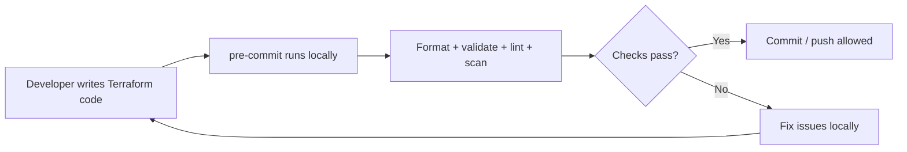

# Terraform Pre-commit Hooks

Pre-commit configuration for Terraform repositories: formatting, validation, linting, security scanning, secret detection and Git conventions, run locally before commit and push.

Copy the configuration files into your Terraform repository and adapt them.

## Workflow



## Quick start

```bash
pip install pre-commit
```

```bash
pre-commit install --install-hooks
```

```bash
pre-commit run --all-files
```

`pre-commit install --install-hooks` installs the `pre-commit`, `commit-msg` and `pre-push` hooks declared in `default_install_hook_types`.

## Configuration

[`.pre-commit-config.yaml`](.pre-commit-config.yaml) is the source of truth for hooks, versions and arguments. It is not copied here, so the README cannot drift from it.

| Stage | Checks |
| --- | --- |
| `pre-commit` | whitespace, EOF, line endings, YAML syntax, merge conflicts, large files, private keys, no direct commit to `main`, Gitleaks, `terraform fmt`, `terraform validate`, provider lockfile, TFLint, Checkov |
| `commit-msg` | Conventional Commits header |
| `pre-push` | branch name `feature/`, `bugfix/` or `hotfix/` followed by a lowercase, hyphen-separated description |

Tool versions (Terraform, TFLint, hook revisions) are examples. Align them with the versions used in your CI.

### Supporting files

- [`.tflint.hcl`](.tflint.hcl): Terraform `recommended` preset, `azurerm` ruleset, plus documentation, naming and module structure rules. Local modules are inspected (`call_module_type = "local"`).
- [`.checkov.yaml`](.checkov.yaml): Terraform framework only, compact output, no external module download. Meant to be shared by pre-commit and CI. Contains a commented template for `skip-path` and `skip-check`: each skipped check needs its ID, a reason and a review reference.

The hooks load these files through `__GIT_WORKING_DIR__`, so keep them at the repository root.

### Provider lockfile

`terraform_providers_lock` runs in `check-lockfile-is-cross-platform` mode for `linux_amd64`, `darwin_amd64`, `darwin_arm64` and `windows_amd64`.

This mode only checks that `.terraform.lock.hcl` holds the expected number of `h1:` checksums for those platforms. It does not check that the checksums are valid or belong to those platforms. Generate the lockfile with the same list:

```bash
terraform providers lock -platform=linux_amd64 -platform=darwin_amd64 -platform=darwin_arm64 -platform=windows_amd64
```

Change the platform list in both places to match the machines and runners you support.

### Git conventions

- `conventional-commit` checks the header format `type(scope)!: description`. It does not validate the full specification (body, footers, `BREAKING CHANGE`).
- `branch-name` runs on `pre-push` and enforces `feature|bugfix|hotfix/<description>`.
- `no-commit-to-branch` blocks direct commits on `main`.

These checks are local and can be skipped (`git commit --no-verify`, hooks not installed). Enforce the same rules on the server with branch protection and CI.

## Beyond pre-commit

Hooks stay limited to fast, deterministic checks. `terraform validate`, TFLint and Checkov do not replace behavioural tests, but `terraform test` depends on each module and can create real cloud resources, with real costs. It belongs in CI, not in a commit hook.

- Every commit: formatting, quick checks, Git conventions, secret detection.
- CI of consuming projects: Terraform tests per module, `terraform plan` on pull requests, gated apply.

### Roadmap

- Minimal example module with a `.tftest.hcl` file.

## Credits

This configuration uses hooks from:

- [antonbabenko/pre-commit-terraform](https://github.com/antonbabenko/pre-commit-terraform): Terraform formatting, validation, linting and security hooks.
- [pre-commit/pre-commit-hooks](https://github.com/pre-commit/pre-commit-hooks): generic repository hygiene hooks.
- [Gitleaks](https://github.com/gitleaks/gitleaks): secret detection.

This repository only adds an opinionated configuration and local Git conventions on top of them. The tools belong to their maintainers and contributors.

## License

Configuration files and documentation in this repository: [MIT](LICENSE). Third-party tools keep their own licenses.
